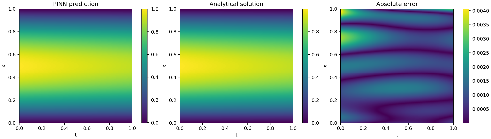

# PINN Heat Equation

A small Physics-Informed Neural Network project for the 1D heat equation:

```text
u_t = alpha * u_xx
```

with domain `x in [0, 1]`, `t in [0, 1]`, initial condition
`u(x, 0) = sin(pi x)`, and boundary conditions `u(0, t) = u(1, t) = 0`.

The analytical solution used for validation is:

```text
u(x, t) = exp(-alpha * pi^2 * t) * sin(pi x)
```

## Result

Default configuration (3 hidden layers of 32 units, Adam, lr 1e-3, 5000 epochs, alpha = 0.01, seed 1234, CPU) gives a relative L2 error of
**1.6e-3** against the analytical solution on an 80x80 grid. Maximum absolute error is about 4e-3.



Notes:

- The network learns the exponential decay of the sin(pi x) mode from the PDE residual plus the initial and
  boundary conditions only. No solution data is used in training.
- Error is largest near t = 0, where the initial-condition term and the PDE residual compete.
- This is a single-seed result on a simple problem with a known solution. It is not a general benchmark.

Reproduce:

```bash
python -m pinn_heat.train --epochs 5000
```

## Setup

Linux / macOS:

```bash
python -m venv .venv
source .venv/bin/activate
pip install -e ".[plot,test]"
```

Windows (PowerShell):

```powershell
python -m venv .venv
.\.venv\Scripts\Activate.ps1
pip install -e ".[plot,test]"
```

## Train

```bash
python -m pinn_heat.train --epochs 5000
```

Windows (PowerShell):

```powershell
python -m pinn_heat.train --epochs 2000
```

For a quick smoke run:

```powershell
python -m pinn_heat.train --epochs 50 --n-collocation 512 --n-initial 128 --n-boundary 128
```

Training writes artifacts to `outputs/`:

- `model.pt`
- `history.csv`
- `comparison.png`, if `matplotlib` is installed

The final relative L2 error is printed at the end of training.

## Test

```bash
python -m pytest
```

Windows (PowerShell):

```powershell
python -m pytest
```
